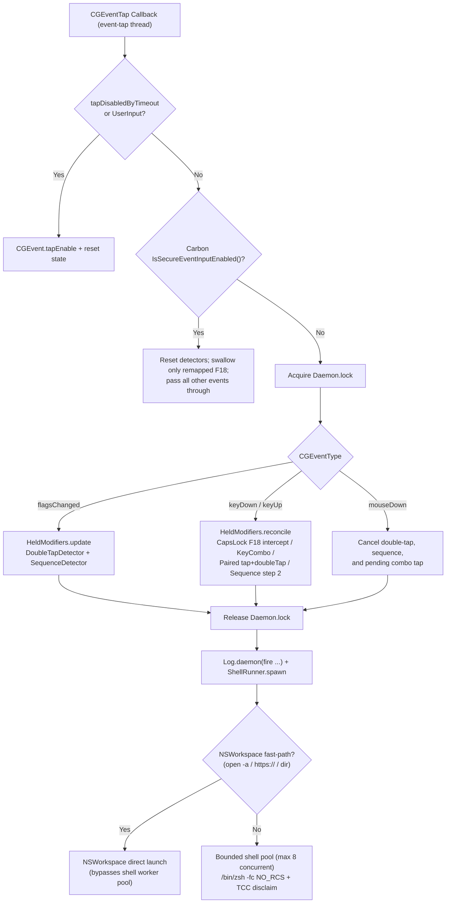

# Hotkeyd Architecture Reference

On-demand technical reference for contributors and AI agents modifying Daemon, event-tap gesture detection, Caps Lock remapping, ShellRunner, or LaunchAgent lifecycle.

---

## 1. System Overview

Hotkeyd splits responsibilities across four Swift targets with zero third-party dependencies and zero C/ObjC targets:

| Target | Execution Context | Responsibility |
| :--- | :--- | :--- |
| HotkeydCore | Shared static library | Pure, launchd-free detectors, config I/O, RuntimeState, PauseState, StatsAnalyzer, StrictModes, CodeTrust, CommandRegistry, InitSupport, ShellCompletions, ManPageGenerator, PeekConfig, PeekModel, PeekSearch, SelectionReader, CapsLock, ShellRunner, Log |
| hotkeyd | User CLI + LaunchAgent daemon | CLI dispatch (shortcuts, init, completions/man, stats, pause/resume, peek), TCC-disclaimed UI helper (__peek-overlay for bento peek + Spotlight Search HUD), LaunchAgent control, and foreground CGEvent tap daemon (hotkeyd daemon run) |
| hotkeyd-dev | Uninstalled developer tool | Interactive TTY-only event-tap inspectors (listen, tap, modtap); excluded from the signed TCC-trusted hotkeyd binary |
| selftest | Plain executable test suite | Self-contained regression suite (no XCTest / swift-testing required); runs under an isolated 0700 HOTKEYD_HOME |

Communication between the CLI and daemon is strictly stateless:
- Configuration lives in a single mode-0600 regular JSON file at ~/.hotkeyd (relocated to $HOTKEYD_HOME/.hotkeyd in sandboxes).
- Daemon health is persisted atomically to ~/Library/Application Support/Hotkeyd/runtime-state.json (mode 0600).
- Config changes propagate through a 125 ms debounced O_EVTONLY file watcher plus atomic launchctl kill SIGHUP; peek and Spotlight Search toggles signal via launchctl kill SIGUSR1 / SIGUSR2; the daemon drives the lazy __peek-overlay helper over a strictly one-way unnamed pipe(2) carrying bounded NDJSON frames.

---

## 2. Event-Tap Pipeline

### Gesture & Rollover Semantics

- **Modifier double-taps (DoubleTapDetector):** Fire on the **second release**, never the second press, so fast Cmd then Cmd+K never misfires. Any intervening keyDown, mouse click, or extra modifier cancels the gesture; releasing a prior typed letter during fast typing rollover preserves tap 1. Default timings: tapMax 250 ms, window 400 ms (configurable 100–600 ms via maxDoubleTapDelayMs), cooldown 400 ms.
- **Key combinations & paired tap/doubleTap:** Matched via BindingIndex with exact side-specific modifiers winning over side-agnostic family bindings (lcmd+space beats cmd+space). When a combo binds both tap and doubleTap, tap 1 waits up to 250 ms (defaultComboDoubleTapWindow, configurable via maxDoubleTapDelayMs) on keyTapQueue; releasing modifiers early or pressing another key flushes the pending single tap immediately. Double-tap-only combos swallow tap 1 so the underlying app does not react before tap 2.
- **Two-step sequences (SequenceDetector):** A clean bare modifier tap (<= 250 ms) arms a short-lived leader window (default 250 ms, configurable 100–1500 ms via maxSequenceDelayMs). Unbound step-2 keys pass through and disarm immediately; firing a bare-modifier doubleTap disarms any active leader; synthetic Apple Silicon Globe (keyCode 179) events following fn are ignored; unsided shift is forbidden as a leader.
- **Modifier pass-through:** Modifier flagsChanged events are never swallowed, so Hotkeyd cannot leave a modifier stuck.

---

## 3. Concurrency & Lock Ordering Matrix

SwiftPM compiles all targets under Swift 5 language mode with explicit synchronization. Violating the lock ordering below can deadlock the event tap.

| Synchronization Primitive | Owner / Scope | Strict Rules |
| :--- | :--- | :--- |
| Daemon.lock (NSLock) | Event-tap hot state: index, held, detector, sequenceDetector, swallowedKeys, pendingKeyTap, lastKeyTap, wasInSecureInput, isPausedLocked/pauseResumeDateLocked, peekConfigLocked/peekModeLocked/peekArmingTriggerLocked/peekGenerationLocked, capsRemapped, tap, waitingForAccessibility | **Leaf lock only.** Never call controlQueue.sync, ShellRunner, launchctl, hidutil, or filesystem I/O while holding Daemon.lock. Always unlock before logging or spawning actions. |
| Daemon.controlQueue (serial, utility QoS) | Config reload, O_EVTONLY watchers, power/HID notifications, RuntimeState/PauseState persistence, SIGTERM/SIGHUP/SIGUSR1/SIGUSR2 handlers, 2s watchdog, CapsLock sync, PeekOverlayBridge (DispatchSourceWrite + DispatchSourceProcess reapers), cachedSearchUsageFingerprint & 0.15s signal rate limits | Allowed to acquire Daemon.lock briefly (**ordering: controlQueue -> lock**). Owns tapActiveState, tapNoteState, configValidState, configErrorState, activeBindingsState, currentConfigState, and capsNeeded. |
| Daemon.keyTapQueue (serial) | Delayed single-tap flush for paired tap+doubleTap combos | Acquires Daemon.lock briefly to check generation and take pendingKeyTap, then releases lock before spawning. |
| io.github.jardondiego.hotkeyd.event-tap (Thread, userInteractive QoS) | Dedicated CFRunLoop hosting the CGEventTap source | Must return quickly so WindowServer does not disable the tap by timeout. All action execution and logging happen asynchronously off this thread. |
| Log serial queue (utility QoS) | daemon.log and actions.log appends + 5 MiB rotation | Asynchronous writes; Log.flush() drains synchronously before daemon exit. |
| ShellRunner.activeLock (NSLock) | Shell worker pool counter (max 8 concurrent shell jobs) + 30s app URL cache | Native NSWorkspace app/URL launches bypass the shell concurrency pool so slow scripts never stall app switching. |

---

## 4. Caps Lock Remapping & Power / Hotplug Lifecycle

macOS toggles Caps Lock below the CGEventTap layer, so Hotkeyd remaps Caps Lock (0x700000039) to F18 (0x70000006D, keyCode 79) via /usr/bin/hidutil whenever ~/.hotkeyd contains an enabled capsLock binding and the event tap is active:

1. **Foreign-mapping protection:** CapsLock.state() reads hidutil UserKeyMapping and refuses to overwrite any non-Hotkeyd mapping (.foreign).
2. **Authoritative LED state:** CapsLock reads and resets the hardware lock state via IOHIDGetModifierLockState / IOHIDSetModifierLockState (IOKit), because CGEventSource.flagsState can falsely report off while typing uppercase.
3. **Sleep/wake & keyboard hotplug:** IORegisterForSystemPower and IOHIDManager keyboard attach/remove notifications run on controlQueue. On system wake or new keyboard attach, Daemon resets modifier state and schedules a debounced Caps Lock re-apply (0.4s / 0.35s).
4. **2s Watchdog (startCapsWatchdog):** Runs on controlQueue every 2s (+/- 500 ms leeway) to detect runtime Accessibility revocation (tearing down tap, disabling Caps Lock remap, updating RuntimeState, notifying user, and re-entering waitForAccessibility) and to clear any stuck Caps Lock LED state while remapped.
5. **Clean restoration:** SIGTERM (watchForTermination), Accessibility revocation, removing the last capsLock binding, daemon stop/uninstall, and hotkeyd panic all restore Caps Lock immediately.

---

## 5. Config Reload, RuntimeState & LaunchAgent Lifecycle

- **Startup sequence (Daemon.start):**
  1. StrictModes.verifySecurePath(binaryPath) + CodeTrust.verify + CodeTrust.verifyCurrentProcess.
  2. Disable Accessibility delegation and live SelectionReader if allowAdhoc or custom config path.
  3. Paths.ensureDirectories() + rotate daemon.log + acquire exclusive 0600 O_NOFOLLOW flock on daemon.lock (exit 6 on contention).
  4. Persist initial RuntimeState, load ~/.hotkeyd, arm O_EVTONLY watcher, register power/HID observers, arm SIGHUP/SIGTERM handlers, start 2s watchdog, and start waitForAccessibility().
- **Config watching:** Watches the ~/.hotkeyd inode directly (O_EVTONLY | O_NOFOLLOW) rather than $HOME, re-arming immediately on atomic rename and debouncing reload by 125 ms. If ~/.hotkeyd does not exist yet or was a symlink, falls back to watching $HOME for creation.
- **LaunchAgent.install:** Verifies binary trust, atomically writes mode-0600 io.github.jardondiego.hotkeyd.daemon.plist, runs launchctl bootout (waiting up to 1.5s for drain so the previous daemon releases daemon.lock cleanly), optionally writes the one-shot 15s .suppress-ax-prompt sentinel, bootstraps with RunAtLoad: true, and only calls launchctl kickstart (without -k) if launchd has not spawned a PID within 500 ms.
- **Termination safety:** Daemon.watchForTermination() calls RuntimeState.remove(at:expectedPID: getpid()) so a dying daemon never deletes a newly started daemon's runtime-state.json.
- **Secure Input freshness:** Daemon checks Carbon.IsSecureEventInputEnabled() only inside event-tap callbacks, so RuntimeState.secureInputActive updates lazily. CLI commands needing real-time status (such as hotkeyd init Step 4) call Carbon.IsSecureEventInputEnabled() directly.

---

## 6. Native Fast-Path, Shell Execution & SELECTED_TEXT

- **Native NSWorkspace fast-path:** Action.migratedFromShellCommand recognizes metacharacter-free open -a/-b <App> [--args ...], open <https://...>, and open <~ | ~/... | /abs/dir> when allowAccessibility is false, cwd is empty, and SELECTED_TEXT is not referenced. Native app and URL launches execute directly via NSWorkspace without spawning /bin/zsh or occupying a shell worker slot.
- **Shell execution:** Runs /bin/zsh -fc <command> (with NO_RCS) in its own process group (POSIX_SPAWN_SETPGROUP) using Darwin posix_spawn, scrubbing environment variables to a safe allowlist with system paths (/usr/bin:/bin:/usr/sbin:/sbin) ahead of Homebrew. Timeouts pin the child with waitid(..., WEXITED | WNOWAIT) under lock before signaling the process group and reaping with waitpid, eliminating PID-reuse kill races.
- **SELECTED_TEXT:** When a command string contains SELECTED_TEXT, Daemon captures the frontmost target app before dispatching; SelectionReader reads the focused AXSelectedText (or hit-tested element, aborting immediately on AXSecureTextField and auth/password UIs) inside the daemon and injects SELECTED_TEXT plus SELECTED_TEXT_STATUS (ok, empty, secure, disabled, untrusted) into the child shell environment without touching the clipboard or granting --allow-accessibility.

---

## 7. Peek Overlay & Spotlight Search HUD (Opt-In)

To preserve a headless, AppKit-free daemon while keeping overlay show/hide under ~5 ms:

- **Pure model (PeekConfig, PeekModel & PeekSearch):** Auto-groups shortcuts in deterministic trigger-family order (fn+, fn >, capsLock+, capsLock >, double-tap modifiers, other), renders side-aware keycaps (L⌘, R⌘, fn, ⇪), redacts inline URIs (userinfo, query, fragment, webhook/token paths) and shell secrets (secret env assignments, Bearer/Basic headers, credential flags, multi-line tails) in PeekLabeler and PeekSearchBuilder.safeCommandPreview, renders all shortcuts at uniform 100% brightness during hold-peek (opt-in via hotkeyd peek enable; default trigger: fn only), marks per-entry spotlight matches in place when holding any modifier while pinned, tags non-helper-runnable bindings ([AX], [SEL], [off]) with direct-key hints, and ranks Spotlight Search results via multi-token fuzzy scoring plus lightweight StatsAnalyzer usage tallies (allocation-free RFC 3339 parsing cached by (dev, ino, size, mtime) log fingerprint).
- **Event-tap integration:** Daemon tracks hold arming, Tab pin-in-place (ignoring initial release of fn until cleared), bare / while pinned to enter Search, pinned modifier spotlighting, and optional KeyTarget toggle / searchToggle hotkeys strictly under Daemon.lock and dispatches lightweight PeekEffect values asynchronously to controlQueue. Firing any global shortcut, entering Secure Event Input (enteredSecureInput), or disabling the event tap auto-hides both Peek and Search HUD.
- **Strictly one-way TCC-disclaimed helper (hotkeyd __peek-overlay):** PeekOverlayBridge spawns a single helper lazily (rate-limited 4 spawns per 10s) over an unnamed pipe(2) using ShellRunner.spawnProcess(..., disclaimResponsibility: true) with F_SETNOSIGPIPE and non-blocking DispatchSourceWrite framing (preserving in-flight frames > 16 KiB through `\n`, coalescing queued frames, tearing down on a 2.0s write-stall timeout) plus persistent per-PID DispatchSourceProcess reapers (SIGTERM with 1.5s SIGKILL escalation) so dead helpers never leak as zombies. The helper starts draining stdin before NSApplication.shared init, retains its controller across app.run() via withExtendedLifetime(controller), sets ShellRunner.disallowAccessibilityDelegation = true, gates show/toggle/execute on !Carbon.IsSecureEventInputEnabled(), uses a non-activating .hudWindow NSPanel for bento peek and a dedicated key-capable SearchHUDPanel for Spotlight Search (immediate Esc close, blur dismiss, ↑/↓ & Ctrl-N/Ctrl-P navigation, ⌘C copy keys, ⌘⇧C copy command), runs only non-AX / non-SELECTED_TEXT shortcuts directly while prompting to press the key directly for [AX] / [SEL] / [off] bindings, reads bounded NDJSON frames (<= 256 KiB), exits immediately on stdin EOF, and auto-exits after 15 minutes idle.
- **Hands-free toggles & signals:** Optional peek.toggle and peek.searchToggle accept any KeyTarget (combo, two-step sequence, or bare modifier double-tap). CLI hotkeyd peek and hotkeyd peek --search signal the daemon via CodeTrust-verified launchctl kill SIGUSR1 / SIGUSR2 (rate-limited to 0.15s intervals on controlQueue); hotkeyd peek [--search] --terminal [--query <text>] works offline with zero ANSI or GUI calls.
